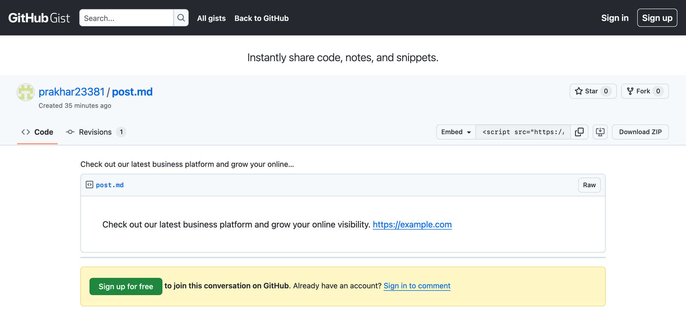
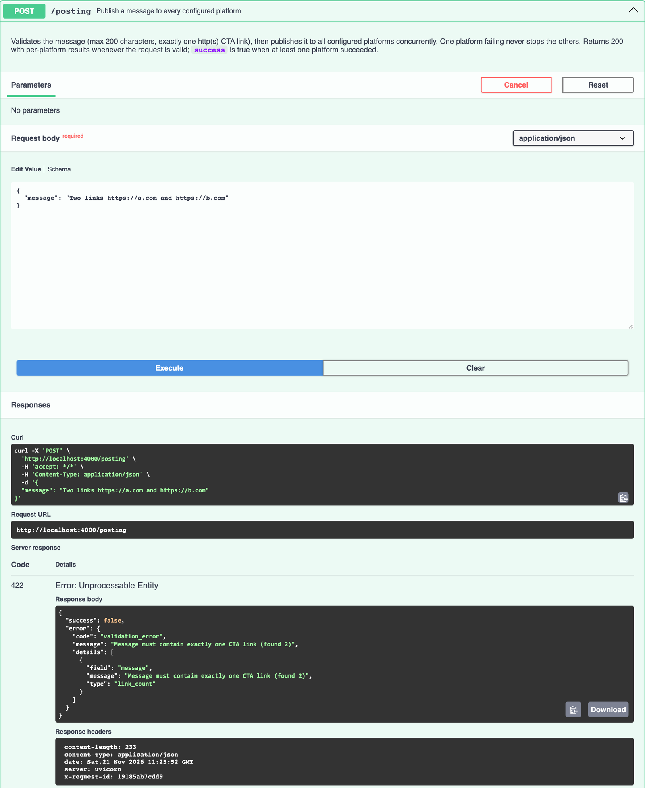

# Automated Multi-Platform Posting API

A FastAPI service with one endpoint, `POST /posting`. It validates a short message containing one call-to-action (CTA) link, then publishes it **concurrently** to every configured platform. For each platform it reports the post URL, whether the post is publicly reachable, and the posting date and time.

**Integrated platforms (8):** Telegram · Mastodon · Bluesky · GitHub Gist · Telegraph · Dev.to · Hugging Face (LLM platform) · Discord

**Verified live:** Telegram, Mastodon, Bluesky, GitHub Gist and Telegraph (see the [real response](#successful-response-http-200) below).

Platform research, API details and rejected platforms: [docs/PLATFORMS.md](docs/PLATFORMS.md)

---

## Quick start

```bash
git clone <this-repo-url> automated-posting && cd automated-posting
python3 -m venv .venv && source .venv/bin/activate
pip install -r requirements-dev.txt        # or requirements.txt to run only
cp .env.example .env                       # then fill in credentials (see below)
uvicorn app.main:app --host 0.0.0.0 --port 4000
```

- API docs (Swagger UI): http://localhost:4000/docs
- Health check: http://localhost:4000/health
- Which platforms have credentials: http://localhost:4000/platforms

Requires Python 3.11+ (developed on 3.12).

## API

### `POST /posting`

```bash
curl -s -X POST http://localhost:4000/posting \
  -H "Content-Type: application/json" \
  -d '{"message": "Check out our latest business platform and grow your online visibility. https://example.com"}'
```

There is no platform field: **the application chooses the platforms itself**, posting to every platform that has credentials configured. Sending extra fields (for example `"platforms": [...]`) is rejected.

#### Successful response (HTTP 200)

```json
{
  "success": true,
  "results": [
    {
      "platform": "Telegram",
      "status": "success",
      "posted_url": "https://t.me/dxora_posting_test/5",
      "public_access": true,
      "date": "2026-11-21",
      "time": "10:50:05",
      "error": null
    },
    {
      "platform": "Mastodon",
      "status": "success",
      "posted_url": "https://mastodon.social/@volage/117654041722407144",
      "public_access": true,
      "date": "2026-11-21",
      "time": "10:50:05",
      "error": null
    },
    {
      "platform": "Bluesky",
      "status": "success",
      "posted_url": "https://bsky.app/profile/dxora-posting-test.bsky.social/post/3n2swjuaq4g2k",
      "public_access": true,
      "date": "2026-11-21",
      "time": "10:50:05",
      "error": null
    },
    {
      "platform": "GitHub Gist",
      "status": "success",
      "posted_url": "https://gist.github.com/prakhar23381/89b0b357729269fc497ae94e56c62422",
      "public_access": true,
      "date": "2026-11-21",
      "time": "10:50:04",
      "error": null
    },
    {
      "platform": "Telegraph",
      "status": "success",
      "posted_url": "https://telegra.ph/Check-out-our-latest-business-platform-and-grow-your-online-11-21",
      "public_access": true,
      "date": "2026-11-21",
      "time": "10:50:06",
      "error": null
    },
    {
      "platform": "Dev.to",
      "status": "failed",
      "posted_url": null,
      "public_access": false,
      "date": null,
      "time": null,
      "error": "Credentials not configured"
    },
    {
      "platform": "Hugging Face",
      "status": "failed",
      "posted_url": null,
      "public_access": false,
      "date": null,
      "time": null,
      "error": "Credentials not configured"
    },
    {
      "platform": "Discord",
      "status": "failed",
      "posted_url": null,
      "public_access": false,
      "date": null,
      "time": null,
      "error": "Credentials not configured"
    }
  ],
  "summary": { "total": 8, "succeeded": 5, "failed": 3 }
}
```

This is a real response from a live run on 21 Nov 2026 with the brief's example message. Every `posted_url` above is a real public post. Dev.to, Hugging Face and Discord are implemented and tested but had no credentials in this run, which shows how an unconfigured platform is reported without affecting the others. Adapter-level failures (for example `"Authentication failed (HTTP 401): Bad credentials"`) look the same, with the platform's own error message.

- `success` is `true` when **at least one** platform succeeded.
- `summary` is an addition to the brief's response shape. Every field from the brief is still present.
- `date` and `time` are in **UTC**. They come from the platform's own timestamp when the API returns one, otherwise from the server clock.
- A failed platform always has `posted_url: null`, `public_access: false`, `date: null`, `time: null` and a readable `error`.
- The response is HTTP 200 for every valid request, even if every platform failed (then `success: false`). The per-platform results are the answer.

#### Validation error (HTTP 422)

```bash
curl -s -X POST http://localhost:4000/posting \
  -H "Content-Type: application/json" \
  -d '{"message": "Two links https://a.com and https://b.com"}'
```

```json
{
  "success": false,
  "error": {
    "code": "validation_error",
    "message": "Message must contain exactly one CTA link (found 2)",
    "details": [
      {
        "field": "message",
        "message": "Message must contain exactly one CTA link (found 2)",
        "type": "link_count"
      }
    ]
  }
}
```

Every request-level error (validation, malformed JSON, unknown route, unexpected server error) uses this same envelope.

### Other endpoints

| Endpoint | Purpose |
|---|---|
| `GET /health` | Liveness check, returns `{"status": "ok"}` |
| `GET /platforms` | Every integrated platform, whether its credentials are set, and a link to its API docs |
| `GET /docs` | Swagger UI with ready-to-run examples |

## Validation rules

| Rule | Error `type` |
|---|---|
| `message` is required and must be a JSON string | `missing`, `string_type` |
| Not empty after trimming whitespace | `message_empty` |
| **At most 200 characters**, counted after trimming, as Unicode code points (one emoji = 1) | `message_too_long` |
| **Exactly one link.** Counted as any `scheme://…` token or bare `www.…` token, so `ftp://x.com` or `www.x.com` is reported precisely instead of as "no link found" | `link_count` |
| The link uses `http` or `https` | `url_missing_scheme`, `url_invalid_scheme` |
| The host is a domain with a real TLD, or a public IP (`localhost`, `https://example` and private IPs are rejected) | `url_missing_tld`, `url_host_not_public`, `url_invalid_host`, `url_missing_host` |
| No `user:password@` and no invalid port | `url_has_credentials`, `url_invalid_port` |
| Unknown fields (e.g. `platforms`) are rejected | `extra_forbidden` |
| *(optional)* The link responds to a request. Off by default to keep the API fast and deterministic; enable with `VERIFY_LINK_REACHABLE=true` | `link_unreachable` |

Trailing sentence punctuation is not part of the link: in `Visit https://example.com.` the link is `https://example.com`. Internationalised domains (e.g. `münchen.de`) are accepted.

## How it works

```text
POST /posting
   │  PostRequest (Pydantic): trim, length, exactly one valid link
   ▼
PostingService.post()
   │  asyncio.gather → one task per platform, each wrapped in asyncio.wait_for(PLATFORM_TIMEOUT)
   ├── TelegramPlatform.publish()  ─┐
   ├── MastodonPlatform.publish()   │  shared httpx.AsyncClient
   ├── BlueskyPlatform.publish()    │  retry policy in utils/http.py
   ├── …                           ─┘
   ▼
for each success: PublicAccessChecker → anonymous GET on posted_url
   ▼
PostingResponse {success, results[], summary}
```

```text
app/
├── main.py               create_app() factory, lifespan (HTTP clients), request-ID middleware
├── config.py             Settings from environment / .env (pydantic-settings)
├── schemas.py            PostRequest + validators, PlatformResult, PostingResponse, ErrorResponse
├── errors.py             exception handlers → one error envelope
├── logging_config.py     key=value logs with request_id
├── api/routes.py         POST /posting, GET /platforms, GET /health
├── platforms/
│   ├── base.py           BasePlatform, PublishOutcome, PlatformError, shared error mapping
│   ├── registry.py       list of adapters (adding a platform = one class + one line)
│   └── telegram.py  mastodon.py  bluesky.py  github_gist.py
│       telegraph.py devto.py     huggingface.py discord.py
├── services/
│   ├── posting_service.py   concurrent fan-out, timeouts, failure isolation, result shaping
│   └── public_check.py      anonymous public-access verification
└── utils/
    ├── validators.py     link extraction and URL validation
    ├── http.py           shared client, retry/backoff policy
    └── text.py           title generation, secret redaction
```

### Design decisions

- **Failure isolation.** Each platform runs in its own task with its own timeout. Every exception, including adapter bugs, is caught and turned into a `failed` result, so one platform never affects another.
- **Concurrency.** All platforms are called at the same time, so the response takes as long as the slowest platform, not the sum of all of them.
- **Retries without double-posting.** A request is retried (at most `MAX_RETRIES`, with exponential backoff and `Retry-After` support) only when the post certainly wasn't created: connection failures, `429` and `503`. A read timeout or other `5xx` after the request was sent is **not** retried, because the post may already exist. The exception is Mastodon, which supports an `Idempotency-Key` header, so the server removes duplicates and all its errors can be retried safely.
- **`public_access` is measured, not hard-coded.** After posting, a separate HTTP client with no credentials or cookies sends a plain `GET` to `posted_url`. `public_access` is true only if the platform's visibility setting is public **and** that request returns 2xx. The visibility part matters because some sites (Discord, for example) return 200 with a login page to everyone. If the check itself can't connect, the platform's visibility setting is used and a warning is logged.
- **Unconfigured platforms are visible.** A platform without credentials appears as `failed` with `"Credentials not configured"`, so reviewers can see every integration that exists. Set `REPORT_UNCONFIGURED=false` to leave them out.
- **Secrets never leak.** Credentials come only from environment variables. Error messages are scrubbed of every known secret value. `httpx` request logging is turned off because the Telegram API puts the bot token in the URL.
- **No vendor SDKs.** Every platform is called with plain HTTPX against its documented REST API, so all adapters share one async client and every adapter is tested with mocked HTTP.

## Getting credentials

Fill in `.env` for each platform you want to use. Platforms left empty are skipped.

| Platform | Steps | Variables |
|---|---|---|
| Telegram | Create a bot with [@BotFather](https://t.me/BotFather) (`/newbot`). Create a **public** channel, give it a username, and add the bot as an admin | `TELEGRAM_BOT_TOKEN`, `TELEGRAM_CHANNEL` (e.g. `@my_channel`) |
| Mastodon | On your instance: Preferences → Development → New application, scope `write:statuses`, then copy the access token | `MASTODON_BASE_URL`, `MASTODON_ACCESS_TOKEN` |
| Bluesky | Settings → Privacy and security → App passwords → Add | `BLUESKY_HANDLE`, `BLUESKY_APP_PASSWORD` |
| GitHub Gist | Settings → Developer settings → Personal access tokens: classic token with `gist` scope, or fine-grained token with account permission *Gists: read and write* | `GITHUB_TOKEN` |
| Telegraph | No signup. Run `python scripts/telegraph_account.py "Your Name"` once and copy the output into `.env` | `TELEGRAPH_ACCESS_TOKEN`, `TELEGRAPH_AUTHOR_NAME` |
| Dev.to | Settings → Extensions → DEV Community API Keys | `DEVTO_API_KEY` |
| Hugging Face | Create a **public** Space or dataset you own, plus a token with write access (Settings → Access Tokens) | `HF_TOKEN`, `HF_REPO_ID` (e.g. `you/announcements`), `HF_REPO_TYPE` |
| Discord | Channel settings → Integrations → Webhooks → New Webhook → Copy URL. Turn on Developer Mode, then right-click the server → Copy Server ID | `DISCORD_WEBHOOK_URL`, `DISCORD_GUILD_ID` |

### Configuration

| Variable | Default | Meaning |
|---|---|---|
| `PLATFORM_TIMEOUT` | `20` | Total seconds allowed per platform, retries included |
| `HTTP_TIMEOUT` | `10` | Seconds per HTTP request |
| `MAX_RETRIES` / `MAX_RETRY_WAIT` | `2` / `5` | Retry count and the longest wait between attempts |
| `REPORT_UNCONFIGURED` | `true` | Include platforms without credentials in the results |
| `PUBLIC_CHECK_ENABLED` / `PUBLIC_CHECK_TIMEOUT` | `true` / `8` | Anonymous GET on each `posted_url` |
| `VERIFY_LINK_REACHABLE` | `false` | Check that the CTA link responds before posting |
| `LOG_LEVEL` | `INFO` | Logging level |

## Tests and lint

```bash
pytest          # 94 tests: validation, service, retry policy, every adapter, HTTP API
ruff check . && ruff format --check .
```

Tests never touch the network: platform APIs are mocked with [respx](https://lundberg.github.io/respx/), and real credentials in the environment are ignored. Coverage includes:

- **Validation:** 200 vs 201 characters, trimming, emoji, 0/1/2 links, bare `www.`, `ftp://`, localhost, private IPs, missing TLD, credentials in the URL, trailing punctuation, IDN, non-string input, extra fields.
- **Service:** all platforms succeeding, mixed results, all failing, a platform that hangs (timeout), proof that platforms run concurrently, unexpected exceptions, secret redaction, unconfigured platforms, the public-access check.
- **Retry policy:** retries on 429 and connect errors; **no** retry on 500 or read timeout for non-idempotent posts; bounded attempts.
- **Adapters:** the exact request sent (URL, headers, payload), the URL built from the response, error mapping (401/403/404/422/502, Telegraph's `ok: false` with HTTP 200), Bluesky's UTF-8 byte offsets, Mastodon reusing one idempotency key across retries, Bluesky session reuse.
- **HTTP API:** the response shape from the brief, the error envelope, malformed JSON, 404s, `/platforms`, OpenAPI examples.

## Screenshots and logs

Every request is logged in key=value form with a request ID, which is also returned in the `X-Request-ID` header. Below is the server log from the live run that produced the [sample response](#successful-response-http-200) above (timestamps in IST, the response in UTC). Full log: [docs/logs/live-run-2026-11-21.log](docs/logs/live-run-2026-11-21.log).

```text
startup platforms=8 configured=['Telegram', 'Mastodon', 'Bluesky', 'GitHub Gist', 'Telegraph']
request_id=ce0c49b895d8 posting started platforms=8 configured=5
request_id=ce0c49b895d8 platform='Dev.to' skipped reason=not_configured
request_id=ce0c49b895d8 platform='Hugging Face' skipped reason=not_configured
request_id=ce0c49b895d8 platform='Discord' skipped reason=not_configured
request_id=ce0c49b895d8 public check url=https://mastodon.social/@volage/117654041722407144 status=200 accessible=True
request_id=ce0c49b895d8 platform='Mastodon' status=success duration_ms=1839 url=https://mastodon.social/@volage/117654041722407144 public=True
request_id=ce0c49b895d8 platform='Telegraph' status=success duration_ms=2352 url=https://telegra.ph/Check-out-our-latest-business-platform-and-grow-your-online-11-21 public=True
request_id=ce0c49b895d8 platform='Telegram' status=success duration_ms=2785 url=https://t.me/dxora_posting_test/5 public=True
request_id=ce0c49b895d8 platform='GitHub Gist' status=success duration_ms=2836 url=https://gist.github.com/prakhar23381/89b0b357729269fc497ae94e56c62422 public=True
request_id=ce0c49b895d8 platform='Bluesky' status=success duration_ms=3210 url=https://bsky.app/profile/dxora-posting-test.bsky.social/post/3n2swjuaq4g2k public=True
request_id=ce0c49b895d8 posting finished success=True succeeded=5 failed=3
request_id=ce0c49b895d8 request method=POST path=/posting status=200 duration_ms=3216
```

(Timestamps, levels and logger names are trimmed here for width; they are in the full log.)

### The same message, live on five platforms

All five posts come from the single request above.

| Telegram | Bluesky |
|---|---|
|  |  |

| Mastodon | Telegraph |
|---|---|
|  |  |



### Validation error in Swagger UI

A message with two links is rejected with a 422 in the shared error envelope, and nothing is posted:



The platforms finished in completion order rather than request order, and the whole request took 3.2 s, about the time of the slowest platform (Bluesky, 3.2 s). Posting one after another would have taken about 13 s, so this shows the platforms really run concurrently.

## Limitations

- A post that times out *after* the request was sent may still have been created. The error message says so, and the request is deliberately not retried.
- Dev.to may rate-limit or moderate brand-new accounts, and rejects posting the same body twice.
- Platform rate limits apply (see [docs/PLATFORMS.md](docs/PLATFORMS.md)). Posting the same test message many times in a row can trigger them.
- The public-access check confirms a page can be loaded anonymously. It does not inspect the page content.
